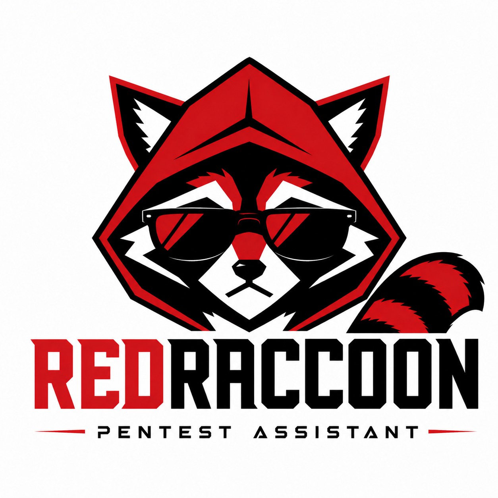

  

Pentesters increasingly use cloud AI to read and assess tool output — nmap, NetExec, Impacket, whatever the engagement needs. The speed gain is real. So is the risk: client IP addresses, hostnames, domains, personal names, and email addresses cross the engagement and land in a third-party model. In many scopes that is not a shortcut. It is a breach of confidentiality.

RedRaccoon exists for that gap. It is a **local** filter: it sanitizes sensitive data **before** the text goes to the cloud, and it restores the real values **after**, when the answer comes back. The AI assistance stays strong. The client identifier does not travel in the clear.

Human in the loop: the app shows a summary of what it masked; **ACEPT** confirms and copies the sanitized text; **CANCEL** discards the round. Nothing is uploaded on its own.

## Technical sheet

| Piece | How it is built |
|------|-----------------|
| What | Local desktop (Linux). Intermediary between the terminal and the cloud AI. |
| Language | Python 3.13+ |
| UI | PySide6 — compact window, avatar, balloon, PAST INPUT, Questions |
| Sanitization | Deterministic, **no LLM** in the filter: engagement blocklist → regex → Microsoft Presidio + spaCy |
| Placeholders | Stable within the engagement (`TARGET_IP_1`, `TARGET_HOST_1`, …) |
| Persistence | SQLite **inside** the engagement workspace; the database is burned on close (recommended) |
| Clipboard | `pyperclip` — a scan comes in through PAST INPUT; the UI does not dump the whole output |
| API secret | None. Everything runs on the machine. |
| Out of v1 | OCR, Cursor MCP interceptor, `.docx`/PDF, Windows `.exe`, several engagements in parallel |

The code is organized by responsibility (`app/`, `core/`, `db/`, `session/`, `ui/`) so it can be read and audited — the filter is not a black box.

## Measured performance

Latest measured round: Enigma. Sum of the first pass. Retests are not included.

**Coverage.** How much of the client’s sensitive information the filter masked. This is the confidentiality protection. The higher it is, the less client data goes to the cloud in the clear.

**Contact with the AI.** How far the model still reaches the same next step after the mask. It drops when the filter hides something that is not a secret and still matters to the reasoning: tool name, version, protocol label, on-screen text.

**False positive.** How much the filter masked without needing to. This is why contact drops. It is not a fourth score: it is the count of those undue masks.

| What it measures | Result | Reading |
|---|---|---|
| Coverage | 26/33 · 79% | Host, IP, and the secret behind a label come out covered. A password or name in running text, a session token, and a bare account name can still pass. |
| Contact with the AI | 86% | The step held. It turned generic only where on-screen text was eaten. |
| False positive | 59/87 · 68% | About two out of three masks were not client data: page text, protocol labels, comments, tool names, or algorithm names. |

RedRaccoon is in a tuning stage. The aim is to raise coverage and contact, and to lower the false-positive rate. The tool is still in training.

## Conclusion

RedRaccoon does not promise magic or absolute “zero leak”. It promises a fast, predictable intermediary with the pentester in control: mask what belongs to the client, leave intact what the AI needs in order to analyze (CVE, version, protocol), and restore the real world when the work asks for it.

The product is in a **build and polish stage**. Next it moves to a tester phase — the moment to use it for real, find the rough edges, and sharpen it before any wider distribution.
